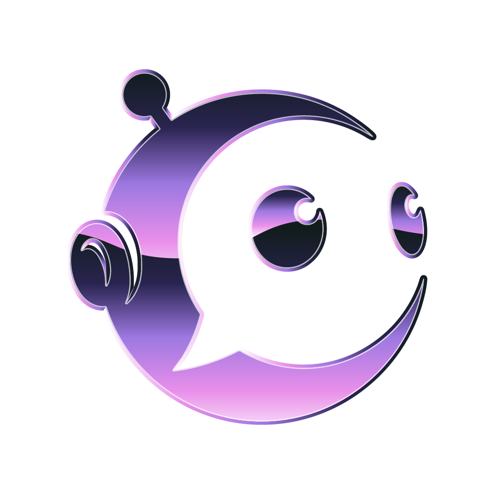
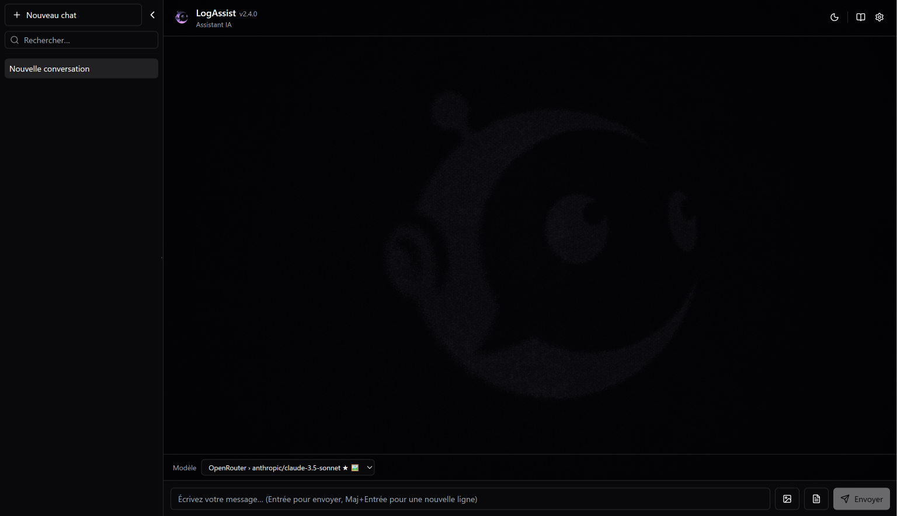
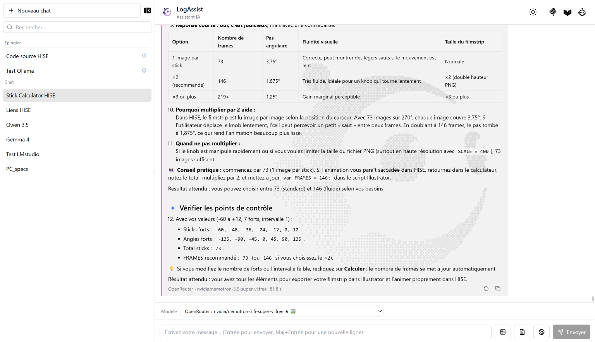
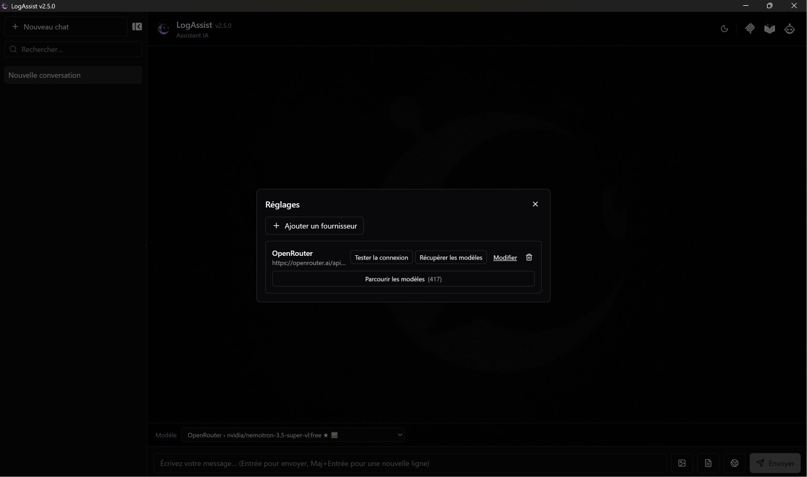
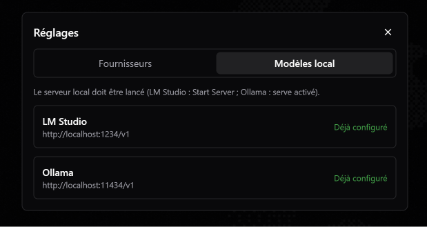
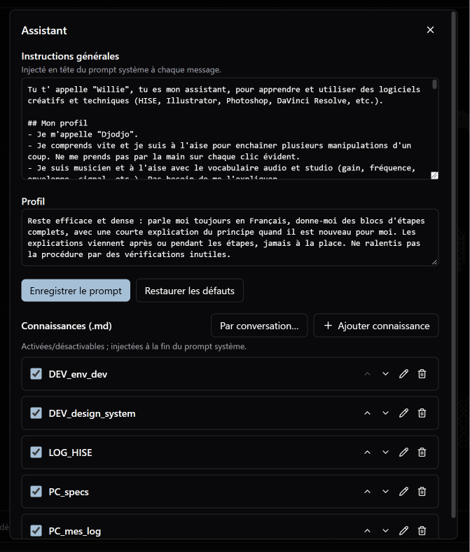
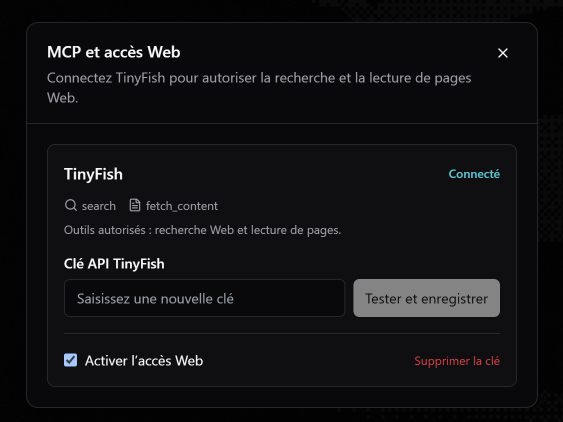

<p align="center">
  
</p>

<h1 align="center">LogAssist</h1>

<p align="center">
  
  
  
</p>

> LogAssist est un assistant IA de bureau pour Windows conçu pour apprendre des logiciels. Il combine conversations persistées, fournisseurs LLM configurables et accès Web contrôlé via MCP (galerie de serveurs importables, TinyFish intégré).

## Fonctionnalités

- Conversations et sources persistées dans SQLite, avec export Markdown.
- Streaming SSE avec rendu Markdown, tableaux GFM, coloration syntaxique et copie des blocs de code.
- Présentation hybride : questions compactes et réponses assistant ouvertes avec suivi de lecture intelligent.
- Auto-scroll respectueux : la lecture reste figée lorsque l'utilisateur remonte, avec retour explicite au nouveau contenu.
- Actions **Retenter** et **Régénérer** sur la dernière réponse admissible, sans dupliquer le message utilisateur.
- Métriques par réponse : premier token, latence, tokens d'entrée/sortie et coût uniquement lorsqu'il est vérifiable.
- Thèmes sombre et clair, arrière-plans dédiés et fenêtre maximisée au lancement.
- Recherche automatique, lecture d'URL et forçage Web pour le prochain message.
- Sources cliquables conservées avec les réponses, sans persister le contenu Web brut.
- Captures éphémères : le binaire d'une image n'est jamais archivé par LogAssist après la session.

<p align="center">
  
  
</p>

- Fournisseurs OpenAI-compatible configurables, notamment OpenAI, OpenRouter et NVIDIA NIM.
- Sélecteur de modèles avec recherche, ajout et activation directe.

<p align="center">
  
  
</p>

- System prompt modulaire et bases de connaissances Markdown par conversation.

<p align="center">
  
</p>

- Galerie de serveurs MCP Streamable HTTP importables par JSON.
- Authentification sans secret, Bearer ou API Key dans un header personnalisé.
- Activation explicite des serveurs et outils, avec confirmation des actions risquées.
- TinyFish reste intégré pour la recherche Web, la lecture d'URL et les sources.

<p align="center">
  
</p>

- Clés API stockées dans le Credential Manager Windows, jamais dans SQLite ou `localStorage`.

## Prérequis

- Windows 10 ou 11 avec Microsoft Edge WebView2.
- Node.js et npm.
- Rust stable avec la cible MSVC.
- Microsoft C++ Build Tools pour compiler Tauri.
- Une clé de fournisseur LLM OpenAI-compatible.
- Une clé TinyFish pour l'accès Web intégré ; les serveurs MCP importés peuvent rester sans authentification ou utiliser Bearer ou une API Key.

## Installation

Exécutez l'installation depuis PowerShell Windows. N'installez pas les dépendances natives depuis WSL.

```powershell
Set-Location C:\dev\LogAssist
npm install
```

## Utilisation

Lancez l'application Tauri en développement :

```powershell
Set-Location C:\dev\LogAssist
npm run tauri dev
```

Dans LogAssist :

1. Configurez un fournisseur et son modèle dans les réglages.
2. Ouvrez **MCP et accès Web** depuis le header.
3. Testez et enregistrez votre clé TinyFish.
4. Activez l'accès Web.
5. Demandez une recherche récente, fournissez une URL ou activez le bouton Web pour le prochain message.

Dans une conversation :

- remontez pendant un streaming pour figer la lecture, puis utilisez **Nouvelle réponse** pour revenir au bas ;
- utilisez **Retenter** sur la dernière erreur fournisseur ;
- utilisez **Régénérer** sur la dernière réponse réussie ;
- interrompez une relance avec **Stop** sans perdre la réponse précédente.

TinyFish reçoit la requête de recherche ou les URL à lire, avec les paramètres bornés nécessaires. Sa propre clé sert à authentifier l'appel côté Rust ; la clé du fournisseur LLM et l'historique complet de la conversation ne lui sont pas transmis.

## Développement

```powershell
# Vérification TypeScript, tests Vitest et build Vite
npm run build

# Tests frontend ciblés ou complets
npm run test

# Synchronisation package.json, Cargo.toml et tauri.conf.json
npm run sync:version

# Build complet avec installateurs Windows
npm run tauri build
```

Les installateurs sont générés dans :

```text
src-tauri/target/release/bundle/msi/
src-tauri/target/release/bundle/nsis/
```

Vérifications Rust :

```powershell
Push-Location .\src-tauri
cargo test
cargo clippy --all-targets -- -D warnings
cargo check
Pop-Location
```

La version 3.0.0 est couverte par 496 tests TypeScript et 21 tests Rust. TypeScript, le bundle Vite et Clippy sans avertissement sont également validés avant publication.

## Sécurité

- Le registre MCP Rust valide les endpoints importés, lie chaque serveur à son secret et limite les appels aux outils activés.
- Rust valide les arguments, les schémas et hôtes URL, les délais et les limites avant tout appel MCP.
- Les résultats Web sont traités comme des données externes non fiables.
- React échappe le contenu distant et n'utilise jamais `innerHTML` ou `dangerouslySetInnerHTML`.
- Le Credential Manager Windows reste le seul stockage des clés API.
- Les erreurs fournisseur sont expurgées avant affichage, journalisation ou persistance.
- Toutes les requêtes SQL utilisent des paramètres liés.

## Contribution

1. Créez une branche dédiée depuis la branche par défaut.
2. Ajoutez les tests avant l'implémentation.
3. Exécutez `npm run build` et les vérifications Rust.
4. Ouvrez une Pull Request avec un résumé du comportement modifié.

## Licence

Aucune licence de redistribution n'est actuellement déclarée dans ce dépôt.
