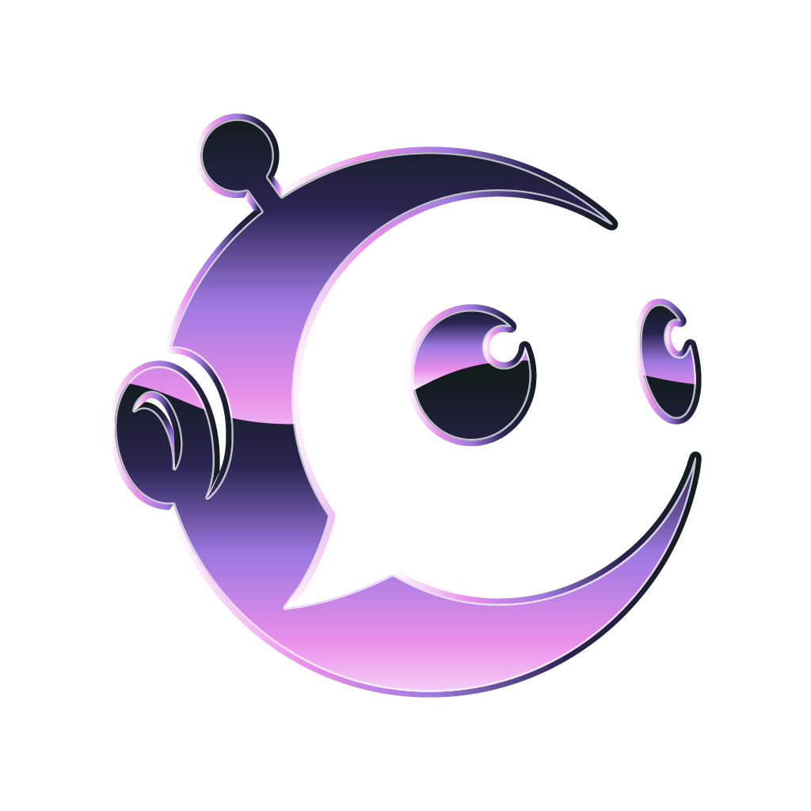
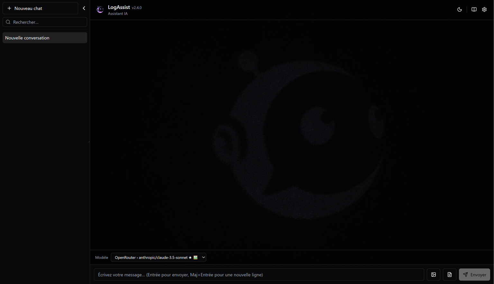
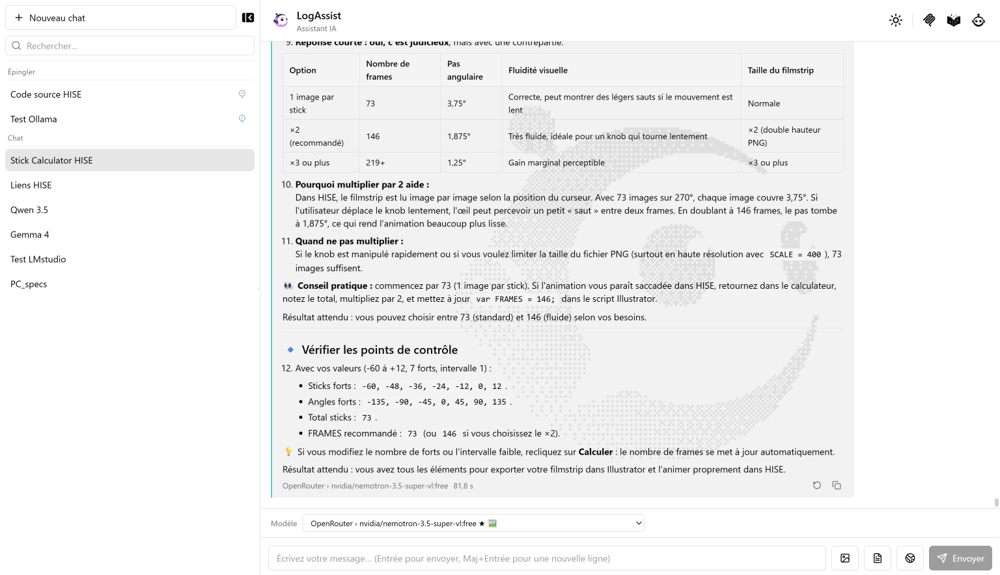
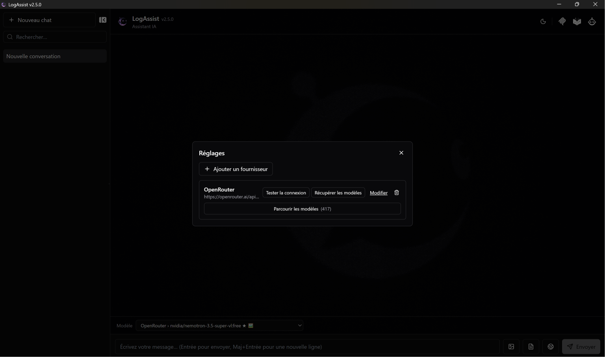
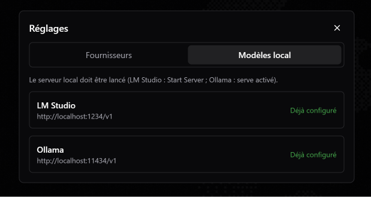
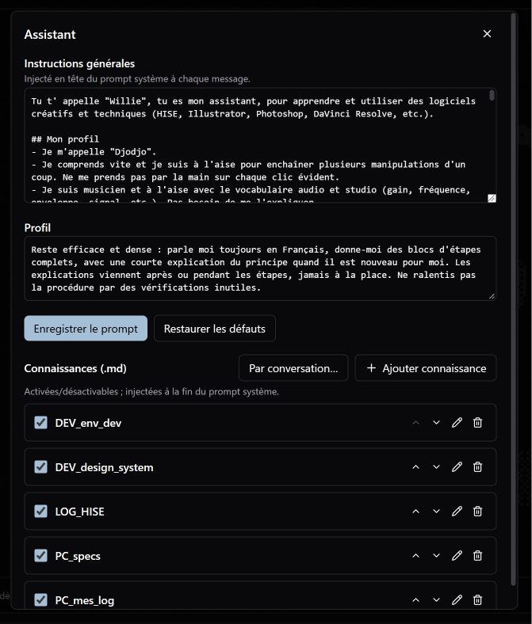
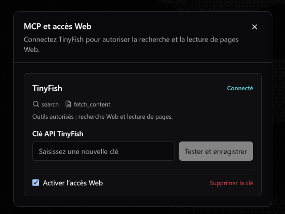

<p align="center">
  
</p>

<h1 align="center">LogAssist</h1>

<p align="center">
    <a href="https://v2.tauri.app/fr/" alt="Tauri site">
        
</a>
    <a href="https://github.com/DjoAHP/LogAssist" alt="LogAssist github">
        <img src="https://img.shields.io/badge/LogAssist-v3.4.0-2D76A4?labelColor=4B4C4E&style=plastic&logo=data:image/png;base64,iVBORw0KGgoAAAANSUhEUgAAAGAAAABgCAYAAADimHc4AAAQAElEQVR4AeydC3RUxRnHQxISIAkFEarWejgqKipan40eoMRG8VgFtQXa2oOHZ3tQWqH4aLESLaKIiFbBImBRrFao4qMqFm3o0QpYtQUEW9GiR4kPpJgXJoRAf/8lu929e%2b/d%2b5jNbmJy5svcO/PNN998/3ndmbl3c3M6/jJqgQ4AMmr%2bnJwOANoTAPv37%2b%2b9e/fuEQ0NDVPwr8IfluHyZX32xloAxp4Ere3UqdNygLgDfx7%2bk1988UVlfX19BxAOVcEIABi4AmPPJ4%2bjIKsbkpeX9wDgHGON6Lg3MAZQwwfm5ubOcDMm4PQgfjbU4SwWMNECxllk2t4CwsW0gqNtI7/EgSYA6OvVfs3NzT/yyuuFD1Dz6f4Og04B3KG0xtH405gATMYfCh3pRU4meUwA4Fl/uqr/eGa2MGLUUgx8PVQJbYE%2bw8BNyNwOvQEYq0jyAP4cJgC/wV8FvQtfE7QF3ieQMYfrCdAQeLPChQaAQr7qoyTbvfI2Njb2x2hXQisw2KcYdS1pfw3JeP3xe0FeXD5M/dFzODKmcX1fTk5OJWDsRO7SxsbGS4gLbQfkBnImMvYEAIXc0LVr1xfdtKyrqzsZg8%2bD3ti3b98W0twNfY80vSGjDjAOQuDl5PM4QOyAHoIuIz%2bFE9U6LjQA3bp1ewxVF0GujoI94cRAwfti9NuZrr4K31XQKU686QhvAeMyZD%2bEHhtoHdPQQS2HoPS60ABIPWr2RApxp66diH56BoZWIWMs1dXVBxF2A4V9Dfo5EQVQpt3hlGUOQKxFN6OTBruCGQFAgrt06TIFxS%2bABMQawkT/xo854qbv2bPn9MrKynxq2ZSCgoLXibyRcK/9OeyBXA15bCbl89ASup0bAXyerglfgf88/pv4zVDUnc7FMoB4GirnOi3OGADSDhCeg6bQIspEhI2HYo5C92cqOq20tPQNCnwHEZ6nsPB6duTzGfQohp7IIHsUunwFvU7EPx8aX1RUVEHXOVXXhI/EPx9/AFSIfieRdhRpVTFe5/pCaDUgLGK6e5hnJTwyGgXAmicFexlDX2EJH8X9AMi024PAZRjuwu3btx%2bOgb%2bPoRf16NHD89QXXZuLi4s3kXY5aSsARK2gjPC5gDCYMUpAGF3XSisAGCSHQizAvx9Ki8M46jp%2bha8aPhrDPdOvX79GU5lRidZQhmn4x9I6FgDELYwNN5mSn3YA6OtHoOxYyLSrY2D/JcYZgHFm4m81nYFVHuDOJ59ShQPCs7W1tSfoOgylFQAZn5q5PIyCdmmRuYKuZnBhYeEtdvHpDCPvWgC/gfzH5%2bfnXxwWhLQBkCbj78a4Y6mFI6mN/%2bA6Y478qwDi5pKSks1hQEgLAA0NDVdSUyw1P7St3kfmcAr9u9CSDAsQCEFFGgcA409hoLo7qEIO6V6j1h8HveAQ32aDjQJAt3MWxtf83qRBHqTWn0HtbzApNFtkGQUAIz1tsmCAORvjX25SZrbJMgYAXY%2bMb3JJYSEPRNdlm8FM62MEAObE06mtF5pSDlnLqfk/MSUvm%2bWEBoB%2b/2wKOBMy5V7du3evdfnClOyskxMaAJ5GtctkrGCMI9O7d%2b/%2bmTGBWS4oFAB0PaPpLi4xVUZk3dUep5pu9gkMAMYqobaarP3v0u/f6qZse4wLDACznqsBweSy8q0A%2bnF7M3Kq8gQCgF0t7dmarP3PUvsXp1K2LcUzObmULlqnL6520zsQAMxStLfb1U2wzzhtC/pM4s5O6%2byCAcZBi2mtb%2bJXQ6vY1argfqh76nCx5DOG1qzDCkPwbyO/e50kBgIAoSOdBAYIf4/NeaMAsA2pM0XPoIta1TjA0Lp9d%2b6HMmubwf0qjDJv165dOrNKsDm3devWQuTfaJE4SMBbwiK3vgGgaf2AlF%2bHjDjAXHHIIYfUGxGGEGrfONbqt3B5DuTmzmXGtRJ%2bHfRy4/MV17t3769Rpph9uK6DtHxeYSfINwAI83QY1y4zu7Dm5mZjtb%2bllqnW22UVC6OGjsT42sLU4QGd3ojFhb1gk%2biIeBnktZEwVYj44Ni1bwBI%2bW3IlFvNxsbfTQjD%2bMPUvaSShUGuY43JGOip8qPCup4c9AUAzXVCqgz9xKOcNtT9JHHkxfhTHCPjIuDT%2baC4kPReAvhF8Tlgw4QuzxcATBUXUYCTETgaStnU4XF1KLfRlcFjJIOunsYTCuaUlPHB9iwSY9s9TmlChh/FgB9ZWETP45GlGSTeAecLACWhP9sIEMugCfTf5dTipxQehABzfZB01jRMi1UprMG29%2bQ52C6Ccgyhdib033Z8QcKoaPciezH%2bcvLRWaOYGN8AxFJyUVxc/GJNTY1OFAfZIG8AzLcQE9ph1G95FYIRRlAjZ%2bMfqjSqldyrKzwB4%2bjYu4LTQZHpMPl%2bA4qdgXUEAKaDaZZ3gNwr0H7oXRR9sq6uLmEQ7tOnTx3aXgnpxAKeZ/eeZ87UjIndSgp%2bynYNZamiTDqNLdJzQg4t%2bqwUSVNG0zNoVuV6MIx8vxoVZAsADINQ8C/UCA1sUaWORPFheXl5LxCfcBydWcUrCJwFeXbIzhgAcUqeQZmKovfoZGoZ/MGoTDs/Pz/fGQCapJrhShK6LbSNBwS9rQLbAUdr0UkIP12KSQA%2bPKBF6P9GAABI2c9Rmaampv3RyKQWwCxB%2b7Be9navx%2bg6dhiR1atXrxrSCoTIfap/NHcjhW3J54MWP5SH/jtDCWhJzEPec1w6HgpmzIqVPQEAar/WeDTFJH3EjUFYL5qp7YoeSN9KXAwsuiLHt2Ai0uL%2bkbY47jbUJbIeCSWAxMj4nEnFai6NOOyitShbWdh0RzQiAQBq5eRoBAJ0bn4piv0Xw97OvQ6lVkXjW/wjGStix7Xh/YhwvUyH5%2b7gNQYAOanG4QV3lO%2b3wVMnp2SslLya5JicZZQ9NmFJAICIw5UAfzMCjqaf13r2pQoDhPU00YTBV%2bEonvCkB8%2bfFe6BjAFAjXqHfEMd1KUcOlbjQW1vLIWFhVvQSW/hJCSgkj8UHxADQMuoRESmcyhzAok1q9F69mP09VcRlwMIC/ETWgFgXUQriH0jgntPj/rkYQwAdJJus8g7yPNIDulmUzbN5CTKGLHOpRXQMZQ18sRPPpPo5hIqaAwALaM65UzCeSx2nYavLkbz3HjWfDJQ9xQJo%2bV4AgBZRgFAXh2VRs8j1RFFvP9bRAvSxMN7Ch%2bcPBcsBdyT8TuRT9LGTAwAmozrYzgj90Tli79JvoVOjN4jx3HpNcojH4OdKt8kUdBX0G8MMhNeDuTe1lFxdAAsUi5bhlYIjAFAXq7zcpQdsWPHjhJq2Tp4rS62vgGfp5eq4eteW1sbA84qMOg9FWAl8%2byBAHybkwzinoYuAjC9r%2bbE1irhMQDWrVunh5m9TrmicE/6tHIWvj6x8hB3Zk7OgVA27D0BIG6eCM%2bQb5p0sIvmfi3UB9l6ye4KAJ/MAHge/hGED4P%2bRFzGXQyAsrIyGd/x4UGaYuhRDCJJR0coVHe1DvHQQlRoXaYk5BlvAfGZIn8Hfe8ajL2A2n4Puq/GN/LQFp9PmOsYAC1CXF90w9DHMDW1/fIVhespGfCcJt8Lweu23OFFRJvnSQAAgyTMUa2lo0YdxiCnzQ9rlFYSIwDAo02HpHiHgHN5%2bv5Sg5AAAM3zD4DgNpfWKp4tAEw/IwBgaF/dCl3WxaT50jiemc6LL2wCAIqghru2AgCy7YLYJ3id7knbgmdKjleixQz3ytse%2bKhwCT1EEgDMcn5PQV2npMRb3ds8yNVizNi6kJXB6R5AT6NWpO1jGE75ZiKcGaL2HxJsmwQAg6mmmXqY8awjht%2bA8FMx5k89J4pjJF3G5%2bNx6qTtksqt7xC5A6DcNXXDKN/UtUdaS9PSK6R5HvmtbOPpwhK2Oq0Mbf2eVt6PijqSh8TUAKiwDMjaK9VK6Mu6dyPA0leuooOwG6tjHA9lgVqPo8Asi%2bAh8DIA2NizZ8/P41VL6oLiIwFhJa1hEAOzNq3LiBPhJTg9QbuuIyVwO9wA4jBWXXXu1IEjO4O9aEXtL8eGMwBA42tCElcAopysr2wBiDUihOjYdTRKfmQPQRcG6GcGZGSVCCpWV7rnyP45149blfMEQHwihM2Jvzd5Dbh%2bxh2TWadNFg%2baN1EuLddrSeQda0a%2bAaBb0mk2656AVW6gexRttUOzgRT0mYgu9bvU%2bsibRJQtqfZLnG8AlAih2u/UpVGidVm7N6PyW1MYs52zMPof4/K03bcOBACt4FGE223MxOXn/5IxRlNZ/wmzLAUrAn2Z88dvcepjhkndj9QOBIASAkDSiK7woIS8xyEj53KC6mAiHb2Dzn1us8hy7FoDA1BQUHAfmehQK54R5/pZYyM5pFkIA%2b7xTDmt50IfoWU7fmQqMADU1l2gbeobER/QZG0HqTTbzJh4uh29m5ZwIAH77GT%2b72qjwABI85axYImuwxBKLmANKmmnLYzM1kzLbOda8kt6YYVyzdQzFHGOLhQAkgrKN%2bOH2eZ7m%2b5M3xZFTNtydDf9oPn0BnafWNDAq884uxYqNAD0b9tQwLWZuWkAgAtIb3eEzzYZ/LkNDQ0T6%2bvr9cNBhbZMaQ5Eh2K6nOvx10KTbLLbS7gnm4QGQJmz6X0fRvQ9h0fJfwKgp9pPMy%2bltumt9wbSLaR5z%2bC%2bmnB9VtjzQQDpG5Rqamp6AfwkBludf9XyQuxgskXmTLrn%2bGmoJfr/t0YAkDgGUb0dnrDUqnA3ArS5UJMTT1VVVTeMfAW17SX4VNv0jnLnOP5CwqcSvxnDVECeDwTEyUh5CcgCf17nzp03Afx8KoDbtutSKpVskVKuGIwBwCC6CWP8GKH6iDaeu4N3DoombX9SuG4U%2bGwMP5el263c6%2b3FgW7SkHUwhpkBvQYY66FfUEuPc0uTKo79iQHoIXCfQ77A1/nYyHtlLmkrKZOvzSxjAEgpuiIdPPWiwAfwXoNxc6m1p2KwsRj8Lvy/YriPKPDfiJuKzCCfi9ee9CyWNd5C3sfI1RfP9a7bGO4HIv8k/L7V1dUH6XcMyKe3dICGwatfA5Qe/8rLy9uIHnPR4XzIi9uG8VN9HiFJjlEAJB0lHqbwkfdidW9HFOxRCivDfJKbm6sfcViCIbQhMxhfH9WwSxYk7KvIK4f0rpu%2b4P4Sum1A0DZmXjtLS0ub0ONT6QA9CZ%2b6F%2blxLDx%2b3D4qlID3kybCaxwASS0qKlpIYSKrgLq3kuIgbcQfbI1ri/eAdxKVKvbakZ8ypAUAKcAsYC61zfNgpDRtkahIpTxsJTwB%2bylH2gCQErSECmZHOvkW/9ssimoPtJ5upwsVTfsjgcuTVgCkVUlJyZso2o3rh6F24dSyGetK6XasC2%2b%2by5d2AKQRiu5BYZ0K0GCooLZMY9WyTRXABwDhs6Ql3AkY30GS7eYE4Vnr0PttlCunIjkuLRPv27UqANIOEJ5l4CqDkt4gVHwWUpW6HAbaIRjf%2bJ5FqwMgvx3AswAAAUpJREFUAzNwfQhNBYSzqVmOu0XizSBFDE%2bFOV1dDnrqBUXj6mQEgGgpAGEtBRwJEHpDXwtc0ahM%2bu%2brxqNXWg0fLWBGAYgqARAraN5qDTqqrifWQA81UXkBfS2jjMfwJ6azxlt1ywoAokpR%2bKcAYlxTU5O%2b2KIPHAX%2bGldUZgr/U1qfFvsGke9QaAldjb5/lCKZueisAiBaLL3liDHup2UMpzvQdzjVMrT%2brrM1sQ9dRPl9%2bHoJcTlGv4Y05wD40eQxmbxSHkCGPy0uKwGILyndQRWGUsu4AUNdAPWhlh4DnQc4el1KH8GbiFH1jDGdtPo1Dy0dTyDsh/AMb25uLocOJa1%2b2HMURtdSeCUyauHPqMt6AOysAyBbIX1z9AmM%2bjC0CKPeiT9LxPVd%2bIvxHwHAp9ireBHKyk3/NgmAHShtNawDgBTIpTv6fwAAAP//N7CN6AAAAAZJREFUAwDIViAqI5US8QAAAABJRU5ErkJggg==" /></a>
</p>

> LogAssist est un assistant IA de bureau pour Windows conçu pour apprendre des logiciels. Il combine conversations persistées, fournisseurs LLM configurables et accès Web contrôlé via MCP (galerie de serveurs importables, TinyFish intégré).

## Fonctionnalités

- Conversations et sources persistées dans SQLite, avec export Markdown.
- Streaming SSE avec rendu Markdown, tableaux GFM, coloration syntaxique et copie des blocs de code.
- Présentation hybride : questions compactes et réponses assistant ouvertes avec suivi de lecture intelligent.
- Auto-scroll respectueux : la lecture reste figée lorsque l'utilisateur remonte, avec retour explicite au nouveau contenu.
- Actions **Retenter** et **Régénérer** sur la dernière réponse admissible, sans dupliquer le message utilisateur.
- Métriques par réponse : premier token, latence, tokens d'entrée/sortie et coût uniquement lorsqu'il est vérifiable.
- Thèmes sombre et clair, arrière-plans dédiés et fenêtre maximisée au lancement.
- Recherche automatique, lecture d'URL et forçage Web pour le prochain message.
- Sources cliquables conservées avec les réponses, sans persister le contenu Web brut.
- Captures éphémères : le binaire d'une image n'est jamais archivé par LogAssist après la session.

<p align="center">
  
  
</p>

- Fournisseurs OpenAI-compatible configurables, notamment OpenAI, OpenRouter et NVIDIA NIM.
- Sélecteur de modèles avec recherche, ajout et activation directe.

<p align="center">
  
  
</p>

- System prompt modulaire et bases de connaissances Markdown par conversation.

<p align="center">
  
</p>

- Galerie de serveurs MCP Streamable HTTP importables par JSON.
- Authentification sans secret, Bearer ou API Key dans un header personnalisé.
- Activation explicite des serveurs et outils, avec confirmation des actions risquées ; bascule globale « Tous les outils » par serveur dans le navigateur d'outils.
- TinyFish reste intégré pour la recherche Web, la lecture d'URL et les sources.
- Connecteur GitHub natif en lecture seule : un dépôt et une branche peuvent être attachés à chaque conversation.
- Trois outils GitHub bornés sont proposés au modèle : cartographie du dépôt, lecture de fichier et recherche de code.

<p align="center">
  
</p>

- Clés API stockées dans le Credential Manager Windows, jamais dans SQLite ou `localStorage`.

## Gestion du contexte

- Avant chaque appel au modèle, LogAssist recherche localement les passages utiles dans les bases de connaissances Markdown actives de la conversation, avec un classement lexical de type BM25. Les documents originaux restent conservés intégralement dans SQLite.
- L'historique complet des messages reste lui aussi dans SQLite. Pour chaque tour, LogAssist sélectionne dynamiquement les échanges récents et les anciens échanges pertinents qui tiennent dans la fenêtre disponible.
- Avec LM Studio, LogAssist détecte la fenêtre du modèle chargé ou, à défaut, celle annoncée par ses métadonnées ; pour les autres fournisseurs OpenAI-compatible, la fenêtre annoncée dans la liste des modèles est utilisée si elle existe. La fenêtre de contexte et la réserve de sortie peuvent être remplacées manuellement dans les réglages de chaque modèle.
- Si le system prompt, le message en cours ou les résultats d'outils ne tiennent pas dans la fenêtre, l'appel est bloqué avec une erreur explicite détaillant les compteurs de tokens (système, message, images, outils, réserve de sortie). Cette version ne produit aucune synthèse automatique des documents ou de l'historique.

## Prérequis

- Windows 10 ou 11 avec Microsoft Edge WebView2.
- Node.js et npm.
- Rust stable avec la cible MSVC.
- Microsoft C++ Build Tools pour compiler Tauri.
- Une clé de fournisseur LLM OpenAI-compatible.
- Une clé TinyFish pour l'accès Web intégré ; les serveurs MCP importés peuvent rester sans authentification ou utiliser Bearer ou une API Key.
- Pour GitHub : un jeton fine-grained limité aux dépôts nécessaires avec `Contents: read-only`. Un PAT classique fonctionne, mais donne un accès plus large.

## Installation

Exécutez l'installation depuis PowerShell Windows. N'installez pas les dépendances natives depuis WSL.

```powershell
Set-Location C:\dev\LogAssist
npm install
```

## Utilisation

Lancez l'application Tauri en développement :

```powershell
Set-Location C:\dev\LogAssist
npm run tauri dev
```

Dans LogAssist :

1. Configurez un fournisseur et son modèle dans les réglages.
2. Ouvrez **MCP et accès Web** depuis le header.
3. Testez et enregistrez votre clé TinyFish.
4. Activez l'accès Web.
5. Demandez une recherche récente, fournissez une URL ou activez le bouton Web pour le prochain message.

Pour utiliser un dépôt GitHub :

1. Ouvrez **Paramètres généraux › Connecteurs › GitHub**.
2. Testez et enregistrez un jeton fine-grained avec `Contents: read-only`.
3. Dans une conversation, utilisez le bouton GitHub de la barre de saisie.
4. Choisissez un dépôt et une branche. La puce `owner/repo@branche` confirme la liaison active.
5. Demandez la structure du dépôt, le contenu d'un fichier ou la recherche d'un symbole.

LogAssist associe un seul dépôt à une conversation. Le jeton reste dans le Credential Manager Windows ; React ne le lit jamais et tous les appels GitHub passent par Rust.

Dans une conversation :

- remontez pendant un streaming pour figer la lecture, puis utilisez **Nouvelle réponse** pour revenir au bas ;
- utilisez **Retenter** sur la dernière erreur fournisseur ;
- utilisez **Régénérer** sur la dernière réponse réussie ;
- interrompez une relance avec **Stop** sans perdre la réponse précédente.

TinyFish reçoit la requête de recherche ou les URL à lire, avec les paramètres bornés nécessaires. Sa propre clé sert à authentifier l'appel côté Rust ; la clé du fournisseur LLM et l'historique complet de la conversation ne lui sont pas transmis.

## Développement

```powershell
# Vérification TypeScript, tests Vitest et build Vite
npm run build

# Tests frontend ciblés ou complets
npm run test

# Synchronisation package.json, Cargo.toml et tauri.conf.json
npm run sync:version

# Build complet avec installateurs Windows
npm run tauri build
```

Les installateurs sont générés dans :

```text
src-tauri/target/release/bundle/msi/
src-tauri/target/release/bundle/nsis/
```

Vérifications Rust :

```powershell
Push-Location .\src-tauri
cargo test
cargo clippy --all-targets -- -D warnings
cargo check
Pop-Location
```

Chaque livraison exécute les tests TypeScript et Rust, le build Vite et Clippy avec les avertissements traités comme des erreurs.

## Sécurité

- Le registre MCP Rust valide les endpoints importés, lie chaque serveur à son secret et limite les appels aux outils activés.
- Rust valide les arguments, les schémas et hôtes URL, les délais et les limites avant tout appel MCP.
- Les résultats Web sont traités comme des données externes non fiables.
- React échappe le contenu distant et n'utilise jamais `innerHTML` ou `dangerouslySetInnerHTML`.
- Le Credential Manager Windows reste le seul stockage des clés API.
- Le jeton GitHub suit la référence `logassist/connectors/github`. SQLite conserve uniquement la liaison non sensible entre une conversation, un dépôt et une branche.
- Le backend GitHub accepte uniquement `api.github.com`, limite les tailles et délais, refuse les chemins sensibles probables et ne fournit que trois outils de lecture.
- Le contenu lu dans un dépôt est traité comme une donnée externe non fiable et n'est jamais persisté brut dans les messages.
- Les erreurs fournisseur sont expurgées avant affichage, journalisation ou persistance.
- Toutes les requêtes SQL utilisent des paramètres liés.

## Contribution

1. Créez une branche dédiée depuis la branche par défaut.
2. Ajoutez les tests avant l'implémentation.
3. Exécutez `npm run build` et les vérifications Rust.
4. Ouvrez une Pull Request avec un résumé du comportement modifié.

## Licence

Aucune licence de redistribution n'est actuellement déclarée dans ce dépôt.
